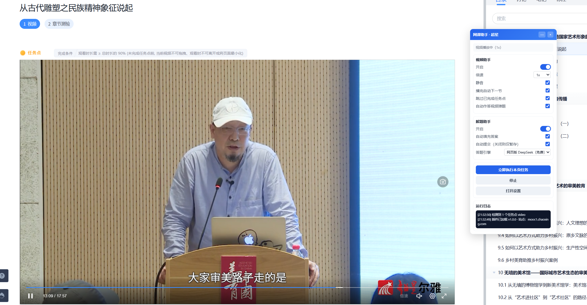
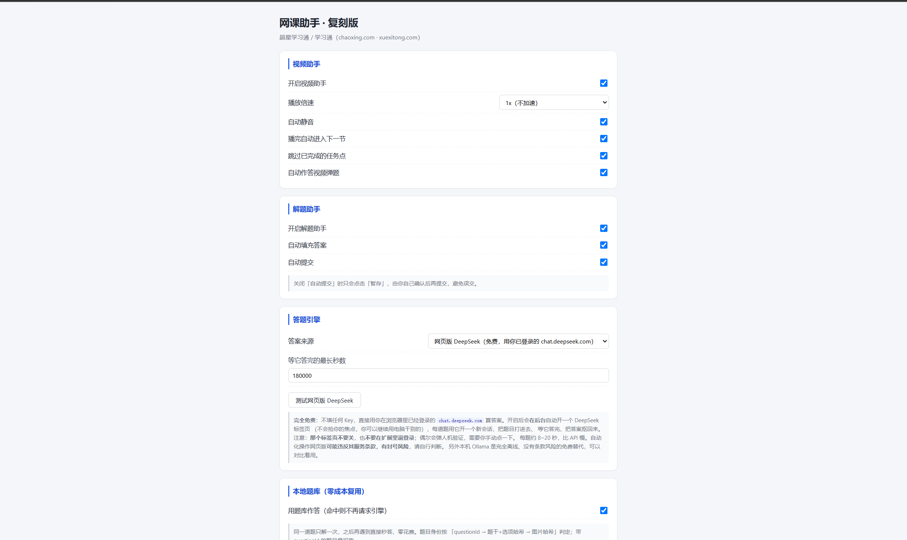
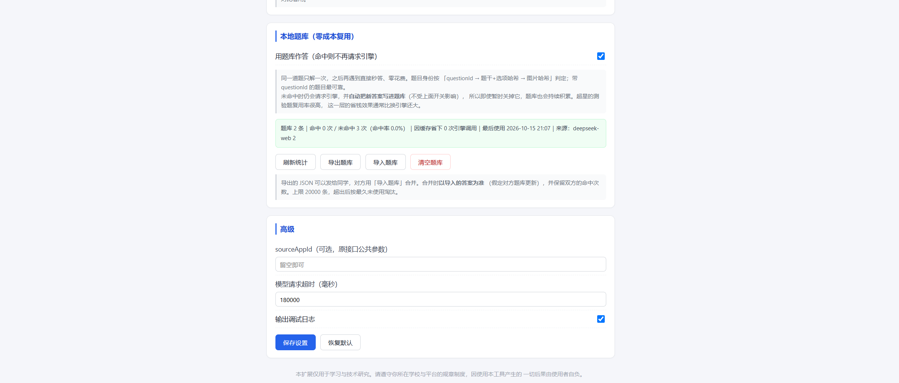

# 网课助手 · 复刻版（超星学习通）


> **对 `daxuesoutijiang.com`「大学搜题酱插件」v1.17.1 的逆向复刻实现。**
> 只保留两个功能：**视频助手** 和 **解题助手**。
> 纯本地 DOM 操作，**不注入远程代码、不上传你的账号信息、不修改课程数据**。

---

## 目录

- [效果](#效果)
- [它能做什么](#它能做什么)
- [安装](#一安装)
- [快速开始](#二快速开始)
  - [1. 免费方案：网页版 DeepSeek（默认，推荐先试这个）](#1-免费方案网页版-deepseek默认推荐先试这个)
  - [2. 网页版模式的注意事项](#2-网页版模式的注意事项)
  - [3. 想 100% 稳定？架一次答题中转](#3-想-100-稳定架一次答题中转)
  - [4. 完全离线：本机 Ollama](#4-完全离线本机-ollama)
  - [5. 本地题库（强烈建议打开）](#5-本地题库强烈建议打开)
- [设置项](#三设置项)
- [工作原理](#四工作原理)
- [已知限制](#五已知限制)
- [目录结构](#六目录结构)
- [自测](#七自测)
- [这个复刻是怎么做的](#八这个复刻是怎么做的)
- [免责声明](#九免责声明)

---

## 效果

**学习页实拍** —— 右侧蓝色面板就是扩展，显示「视频播放中 (1x)」和实时运行日志：



**设置页** —— 四个分组：视频助手 / 解题助手 / 答题引擎 / 本地题库：



**本地题库** —— 命中过的题会记下来，下次零花费秒答，还能导出给同学合并：



---

## 它能做什么

| 功能 | 说明 |
| --- | --- |
| **视频助手** | 自动播放章节里的视频类任务点，可设倍速，自动处理视频弹题，播完自动进入下一节 |
| **解题助手** | 自动识别测验/作业页的每一道题，求解并自动填充答案；学习页内嵌测验可选自动提交，独立考试/作业页只填不提交 |

按需求，**截屏搜题、划词翻译、AI 对话已剔除**；**平台只支持超星（`chaoxing.com` / `xuexitong.com`）**。

> **视频助手完全不需要任何引擎** —— 它是纯本地 DOM 操作（点播放、设倍速、跳下一节），装完就能用。

解题引擎是**可插拔**的，五种来源任选（设置页「答案来源」下拉）：

| 来源 | 谁出算力 | 同学装上能用吗 | 花费 |
| --- | --- | --- | --- |
| **网页版 DeepSeek**（`web`，默认） | 你自己已登录的 `chat.deepseek.com` | ✅ 零配置，登录一下就能用 | **0**（用你的网页版账号） |
| **答题中转**（`relay`） | 你架的中转服务（见 `server/`） | ✅ 零配置，填个地址就行 | 你的 Key，一次架好全员共用 |
| **仅本地题库**（`bank`） | 本地 JSON，不联网 | ✅ 能装，但只有题库里已有的题能答 | 0 |
| **大模型**（`llm`） | 自己填的 OpenAI 兼容接口（可填本机 Ollama） | ❌ 每人得自己配 | 本机 Ollama 免费；云端可能收费 |
| **原服务器接口**（`origin`） | `daxuesoutijiang.com` | ❌ 每人得自己买权益 | **没权益反而要花钱** |

外加一层**本地题库**：同一道题只解一次，之后秒答、零花费；支持导出/导入与同学合并。

> **为什么默认是「网页版 DeepSeek」？** 因为默认值必须是「同学装完不用填任何 Key 就能用」的那个。
> 网页版模式用**你自己的 DeepSeek 网页账号**作答，免费、不需要 API Key、不需要架服务。
> 代价是每题要 8~20 秒（要开一个新对话把题目打进去），偶尔会撞上「消息发送频繁」的限流。
> 想更快更稳，见 [§3 架一次答题中转](#3-想-100-稳定架一次答题中转)。

---

## 一、安装

本项目**没有依赖、不需要构建**，直接加载源码目录即可。

**Chrome**

1. 地址栏输入 `chrome://extensions` 回车
2. 右上角打开 **开发者模式**
3. 点左上角 **加载已解压的扩展程序**，选择本目录（含 `manifest.json` 的那一层）
4. 要求 **Chrome 111+**（MAIN world content script 需要）

**Edge（步骤略有不同）**

1. 地址栏输入 `edge://extensions` 回车
2. **左侧栏最下方**打开 **开发人员模式**（Edge 把它放在左边，不在右上角）
3. 点上方 **加载解压缩的扩展**
4. 选择本目录 —— 要选到**含 `manifest.json` 的那一层**，不要选它的上级目录
5. 要求 **Edge 111+**（Edge 与 Chrome 同为 Chromium 内核，现在的版本都远超这个要求）
6. 加载后扩展图标可能被折叠：点地址栏右侧的 **扩展** 图标（拼图块），把「网课助手·复刻版」**固定**到工具栏

> Edge 会提示「来自其他来源的扩展」之类的字样，只要开发人员模式是开的，加载本地目录不会被拦。
> 如果公司/学校通过组策略锁了扩展安装，会看到「已由组织管理」的提示，那就需要换用个人版 Edge 或 Chrome。

---

## 二、快速开始

### 1. 免费方案：网页版 DeepSeek（默认，推荐先试这个）

**这是默认设置，装完不用配任何东西。**

原理：扩展在后台开一个 `chat.deepseek.com` 标签页，**用你自己在浏览器里已经登录的账号**，
把题目打进去、把答案抠回来。不碰 API、不填 Key、不花钱。

**第一次用：**

1. 装好扩展 → 打开任一课程的**章节学习页**（`/mycourse/studentstudy?...`）
2. 页面右上角出现蓝色面板 → 把「**视频助手 / 开启**」打到**开** —— **它自己就开始跑了**
3. 遇到题目时，扩展会在后台开一个 DeepSeek 标签页
   - **没登录过** → 那个标签页会被自动**切到前台**，面板上显示：
     > 请先在刚打开的 chat.deepseek.com 标签页里登录你的账号（登录完成后回到课程页重开一次即可）。
     > 本模式用你自己的 DeepSeek 网页版账号作答，免费、不需要填任何 Key。
   - **登录过后** → 全自动，你继续用电脑干别的就行（标签页在后台，不抢焦点）
4. 想验证通道是否正常：设置页 → **测试网页版 DeepSeek**

**这个标签页有两个「不要」：**

- ❌ **不要关掉它** —— 关了这道题就失败了（下一题会重开一个）
- ❌ **不要在它里面手动提问/切会话** —— 扩展靠固定位置读答案，你插一脚就会读错

> 面板里「立即执行本页任务」只是手动重跑一次用的（比如你中途停了想继续）。

**视频助手不需要任何 Key、任何服务**，因为它做的全是对页面本身的操作：

- 找到 `.ans-job-icon` / iframe 里的视频任务点，逐个播放
- 设倍速（读超星自己的 `doubleSpeedValue` cookie，见 [§三 设置项](#三设置项)）
- **反检测**：MAIN world 补丁吞掉页面注册的 `ratechange` / `seeked` / `seeking` 监听器，
  否则超星会发现你在加速
- 视频弹题自动作答（需要上面配置解题引擎）
- 播完点 `#prevNextFocusNext` 跳下一节

> 只要视频助手，那到此为止就够了 —— 后面全是给解题助手准备的。

### 2. 网页版模式的注意事项

网页版模式**能用、免费**，但它是在「自动化操作一个供人使用的网页」，所以有几条物理限制：

| 现象 | 原因 | 怎么办 |
| --- | --- | --- |
| 每题要 **8~20 秒** | 每个问题都要开新对话、等它想完 | 想快就架中转（§3），一道题 0.3~0.7 秒 |
| 提示**「消息发送频繁」** | DeepSeek 对免费网页版有静默限流 | 等一会儿再点「立即执行」；或改用中转 |
| 弹出**人机验证** | 登录态过期 / 请求太密 | 切到那个标签页手动点一下验证，然后继续 |
| 某题**答案不对** | 网页版模型也可能答错 | 扩展会优先查本地题库，用久了命中率上来自动规避 |
| 答题过程中 **DeepSeek 改了页面结构** | 官方前端改版 | 需要更新 `src/content/deepseek.js` 里的选择器（见 [§五](#五已知限制)） |

> ⚠ 自动化操作网页可能违反其服务条款，有**封号风险**，请自行判断。
> 想彻底避开这个风险，用 §4 的本机 Ollama —— 完全离线、没有条款问题。
>
> 网页版通道只发送**题目文本**，不发送你的课程页面、账号 token 或任何其他信息。

### 3. 想 100% 稳定？架一次答题中转

**这是让「下载即用、同学零配置、又快又稳」同时成立的办法。**

原因：原版装完就能答题，是因为题目截图发到 `daxuesoutijiang.com`，答案由**他们的服务器**算。
CRX 里没有「答案从哪来」这段 —— 那是他们花钱养的算力，物理上掏不出来。
所以完整复刻只有一条路：**你自己扮演那个角色**。

`server/answer-relay.mjs` 就是这个角色的实现：**单文件、零依赖、只用 Node 标准库**。
为了少让你敲命令，`server/` 里配了两个双击就能跑的脚本。

#### 最省事：双击几个 bat

| 什么时候 | 双击 | 它干什么 |
| --- | --- | --- |
| 第一次架中转 | `server\启动中转.bat` | **第一次跑带你选上游并填 Key**（推荐云端 DeepSeek，也可选本机 Ollama）→ 验 Key/拉起模型 → 尝试放行防火墙 8787 → 探测局域网 IP → 生成口令并存回配置 → 打印「该填进扩展的两行」→ 启动服务 |
| 要发给同学（先做一次） | `server\放行防火墙.bat` | 弹一次 UAC 提权，放行入站 TCP 8787。**不放行同学会一直连不上** |
| 要发给同学 | `server\打包给同学.bat` | 复制干净源码到临时目录（**不动你的源文件**）→ 自动改写 `src/background/index.js` 顶部三个常量**并同步改写 `src/options/options.js` 的 DEFAULTS** → 语法自检 + 全部自测 → **删掉整个 `server` 目录并扫一遍有没有泄漏 Key** → 打出 `网课助手-零配置版-<日期>.zip` |
| 要存档/发布 | `server\pack-neutral.ps1` | 打**中性包**：干净源码、默认「网页版 DeepSeek」、不含你的地址口令，谁装上都能自己配 |

流程就是：双击第一个 → 把它打印的**地址**和**口令**填进扩展设置页的「答题中转」→ 点「测试中转」。
自己这份就通了。要发人时再双击后两个。

> **上游怎么选**：推荐 **DeepSeek 云端**（`deepseek-chat`，约 ¥1/百万字，一道题 ≈ ¥0.0007 元，
> 每题 0.3–0.7 秒，不占你电脑的 CPU、没有冷启动）。要一分钱不花就选**本机 Ollama**
> （免费，但得下 4.7 GB 模型，冷启动慢）。
>
> ⚠ **两种都要求你自己的电脑开着**：模型在云端或本机是一回事，**中转进程跑在你电脑上**是另一回事。
> 想让同学在你关机时也能答题，只能把 `server/` 整个拷到一台常开的机器/云服务器上（见
> [`server/README.md`](server/README.md) §五）。
> 两种都由 `server/relay-config.json` 决定，改这个文件即可切换，不要改代码。

#### 手工跑（不想用脚本时）

```bash
cd server

# 最少一行就能跑（纯题库模式，不调模型）
node answer-relay.mjs

# 有模型才真正能答题（DeepSeek 举例）
UPSTREAM_BASE=https://api.deepseek.com/v1 \
UPSTREAM_KEY=sk-你的key \
UPSTREAM_MODEL=deepseek-chat \
RELAY_TOKEN=和同学约好的口令 \
node answer-relay.mjs
```

启动后：

1. 浏览器打开 `http://127.0.0.1:8787/health`，出 JSON 就是活了
2. 扩展设置页 → 答案来源选 **答题中转** → 地址填 `http://127.0.0.1:8787/solve` → 口令填一样的
3. 点 **测试中转**，会显示 `模式=relay+bank｜上游模型 deepseek-chat｜题库 0 条｜口令=需要`

**要发给同学？** 用上面的 `打包给同学.bat` 最省事；等价于手工把
`src/background/index.js` 最上面三行改成：

```js
const DEFAULT_RELAY_URL     = "http://192.168.1.10:8787/solve";  // ← 改成你自己的地址
const DEFAULT_RELAY_TOKEN   = "换成你自己的口令";                    // ← 你的口令
const DEFAULT_ANSWER_SOURCE = "relay";                            // ← 从 "web" 改成 "relay"
```

打包发出去，同学那边**装上、打开学习通章节页、把「视频助手 / 开启」打开**就行，不需要任何 Key。

> 想一分钱不花：**你自己**装一次 Ollama 当上游
> （`UPSTREAM_BASE=http://127.0.0.1:11434/v1 UPSTREAM_KEY=ollama UPSTREAM_MODEL=qwen2.5:7b`），
> 同学那边依旧什么都不用装 —— 代价是你的电脑得一直开着。
>
> 部署到公网服务器 / Cloudflare Workers / 局域网共享、防火墙放行等，见
> **[`server/README.md`](server/README.md)**。

### 4. 完全离线：本机 Ollama

**第一步：装 Ollama（免费开源，一次性）**

1. 到 <https://ollama.com/download> 下载安装包并安装
   （国内若下载失败，可用镜像：`https://gh-proxy.com/https://github.com/ollama/ollama/releases/download/v0.40.3/OllamaSetup.exe`）
2. 打开命令行，拉一个模型：

```bash
# 纯文字，约 4.7 GB —— 够用，速度快
ollama pull qwen2.5:7b

# 想让它能看懂题目里的图片，约 6 GB
ollama pull qwen2.5vl:7b
```

3. 确认服务在跑：`ollama list` 能列出模型即可（装好后 Ollama 一般会常驻）

**第二步：设置页 → 答案来源选「使用大模型」→ 点预设**

- 点 **「本机 Ollama · 纯文字（免费）」** 或 **「本机 Ollama · 支持图片（免费）」**
- 点 **测试连接** —— 第一次会等十几秒（模型加载进显存），看到「连接成功 ✓」就好了

预设会自动填好：

| 字段 | 值 |
| --- | --- |
| API 地址 | `http://127.0.0.1:11434/v1` |
| API Key | `ollama`（本机服务不校验，随便填） |
| 模型名称 | `qwen2.5:7b`（纯文字）/ `qwen2.5vl:7b`（能看图） |

**不想装 Ollama？** 那就填任意 OpenAI 兼容地址：

| 服务 | API 地址 | 备注 |
| --- | --- | --- |
| 智谱 GLM-4-Flash | `https://open.bigmodel.cn/api/paas/v4` | 该档位免费 |
| 硅基流动 | `https://api.siliconflow.cn/v1` | 注册赠额度 |
| Google Gemini | `https://generativelanguage.googleapis.com/v1beta/openai/` | 有免费层，视觉强 |
| OpenRouter | `https://openrouter.ai/api/v1` | 有 `:free` 模型 |
| DeepSeek | `https://api.deepseek.com/v1` | 很便宜但不是免费 |
| OpenAI | `https://api.openai.com/v1` | 要花钱 |

> 题目里若含图片，扩展会把截图作为视觉消息（`image_url`）一起发送。**纯文字模型答含图题时会漏掉题干里的图**，这类题请用视觉模型。

### 5. 本地题库（强烈建议打开）

设置页「本地题库」一节默认已开。它的作用：

- 求解前先查题库，**命中就直接用，不请求任何引擎** → 零花费、零等待
- 题目身份按「`questionId` → 题干+选项哈希 → 图片哈希」判定（带 `questionId` 的题最可靠）
- 未命中时照常请求引擎，并把新答案**自动写进题库**（不受开关影响，所以题库会持续积累）
- **导出题库** 得到一个 JSON，可以发给同学；对方用 **导入题库** 合并（合并时以导入的答案为准，保留双方命中次数）

> 超星的测验题复用率很高（同一门课、不同班级经常出同一道题），所以这一层的省钱效果通常比换引擎更大。上限 20000 条，超出后按最久未使用淘汰。

### 6. 打开学习通章节页

进入任一课程的**章节学习页**（`/mycourse/studentstudy?...`），页面右上角会出现**控制面板**：

```
网课助手 · 超星
待机（请在上方面板开启助手）
─── 视频助手 ───
开启              [ ]
倍速              2x ▾
静音              [x]
播完自动下一节     [x]
跳过已完成任务点   [x]
自动作答视频弹题   [x]
─── 解题助手 ───
开启              [ ]
自动填充答案       [x]
自动提交（关闭则仅暂存）[ ]
答题引擎          网页版 DeepSeek ▾
[立即执行本页任务] [停止] [打开设置]
```

开启即可：

- 打开「视频助手」→ 自动从当前任务点开始刷视频
- 打开「解题助手」→ 自动解当前页的测验（把已有的 `.testTit_status` 状态也考虑进去）

面板可**拖动**、可**折叠**、可**关闭**；日志区实时打印每一步做了什么。

> 工具栏图标弹窗里也能开关总开关、改倍速/引擎/自动提交，并显示当前页状态。

### 7. 独立测验页（考试 / 作业）

超星有两套答题页面，本扩展两套都支持：

| 页面 | 地址特征 | 题目容器 |
| --- | --- | --- |
| **学习页内嵌测验** | `/mycourse/studentstudy` 里的任务 iframe | iframe → `#frame_content` → `#ZyBottom` 内的 `.singleQuesId` |
| **独立考试 / 作业页** | `/exam-ans/exam/test/reVersionTestStartNew`、`/exam-ans/mooc2/exam/preview`、`/mooc-ans/mooc2/work/dowork` | 顶层 `document` 的 `.questionLi`，序号表在 `#topicNumberScroll` |

打开独立测验页后，在面板点「解题助手」开启（或点「立即执行」）即可逐题求解并**直接填充**；

> 独立测验页**只填不提交**（与原插件一致）——填充完后你确认无误，再点页面上的提交按钮。
> 试卷查看页（`/exam-ans/exam/test/reVersionPaperMarkContentNew`、`/mooc-ans/mooc2/work/view`）不做自动作答。

---

## 三、设置项

| 分组 | 项 | 默认 | 说明 |
| --- | --- | --- | --- |
| 视频助手 | 开启视频助手 | 关 | 视频/音频/PDF/文本任务点的总开关 |
| | 播放倍速 | 1x | 1 ~ 16x，运行时每秒重申一次。若你从未改过这一项，扩展会**自动采用你在超星播放器里选过的倍速**（读 `doubleSpeedValue` cookie），与原插件行为一致 |
| | 自动静音 | 开 | 避免多标签页同时出声 |
| | 播完自动进入下一节 | 开 | 队列走完后点左侧目录的下一节 |
| | 跳过已完成的任务点 | 开 | 已完成（含「已完成」标记）的直接跳过 |
| | 自动作答视频弹题 | 开 | 播放中弹出的选择题自动作答；关掉则只尝试跳过 |
| 解题助手 | 开启解题助手 | 关 | 测验/作业题的开关 |
| | 自动填充答案 | 开 | 关掉只求解、不填 |
| | 自动提交 | 开 | **关掉只会点「暂存」**，由你自己确认后提交 |
| 答题引擎 | 答案来源 | **网页版 DeepSeek** | `web` 网页版（默认，免费）｜`relay` 答题中转｜`bank` 仅题库｜`llm` 大模型｜`origin` 原插件服务器 |
| | 等它答完的最长秒数 | 180000 | 网页版模式默认 3 分钟 |
| | 中转地址 + 口令 | 空 | 选 `relay` 时填，例如 `http://192.168.1.10:8787/solve`；口令与中转的 `RELAY_TOKEN` 一致 |
| | 预设按钮 | — | 「本机 Ollama · 纯文字」/「本机 Ollama · 支持图片」，点一下即填好并存档（选 `llm` 时用） |
| | API 地址 / Key / 模型 / 温度 / 强制 JSON | 空 / 空 / `gpt-4o-mini` | OpenAI 兼容；强制 JSON 关掉可兼容不吃 `response_format` 的服务 |
| 本地题库 | 启用本地题库 | **开** | 命中则**完全不请求引擎**（零花费零等待）；未命中时新答案照常入库，不受此开关影响 |
| | 统计 | — | 条数 / 命中率 / 因缓存省下的引擎调用次数 |
| | 导出 / 导入 / 清空 | — | 导出 JSON 可与同学合并（合并时以导入的答案为准） |
| 高级 | 请求超时(ms) | 180000 | 本机模型冷启动较慢，默认 3 分钟 |
| | sourceAppId | 空 | 原接口公共参数，一般留空 |
| | 输出调试日志 | 开 | 关掉可减少控制台噪声 |

> 选 `bank` 时，「启用本地题库」这一项**必须保持勾选**，否则没有任何答案来源可用（面板会提示一次并跳过题目）。

---

## 四、工作原理

1. **任务扫描**（MAIN world）遍历页面上的 `iframe` 与 `.blockquote-wrap`，凡是 `/ananas/modules/<x>/`、`/ananas/dialog/ballchart` 或「展开式测验块」都算一个任务点，算好 `data-dx-task-id` 后 `postMessage({type:"cxTypes", ...})`。
2. **内容脚本**把任务归一化为 `video / audio / pdf / work / text`，按顺序排队执行。
3. **本地题库先查**：每道题先按「`questionId` → 题干+选项哈希 → 图片哈希」派生 key 查题库；命中就直接用（**不请求任何引擎**，零花费零等待），未命中才走引擎，拿到答案后自动入库——所以用得越久越省。
4. **未命中时按「答案来源」分派**：`web`（网页版 DeepSeek，**默认**，免费）→ `relay`（答题中转，**分享场景推荐**）→ `llm`（任意 OpenAI 兼容接口，填本机 Ollama 可完全免费离线）→ `origin`（原插件服务器，需该站权益）→ `bank`（纯题库，不联网，查不到就安静跳过）。都没有可用配置时返回 `errNo -100`，面板只提示一次然后跳过该题，**不会刷屏报错**。
5. **网页版通道**（`src/content/deepseek.js` + `src/background/web-solver.js`）：后台开/复用一个 `chat.deepseek.com` 标签页 → 用 React 受控赋值把题目打进 `textarea` → 点发送 → 轮询**新出现的**回答元素（用元素身份而非元素个数判断，避免把上一题的答案当成本题答案）→ 抠出文本返回。**每道题开一个新会话**，题目之间互不干扰；批量题目会合并成一条提示词一次问完，减少限流。
6. **视频类任务**：定位任务 iframe 里的 `<video>`，设 `playbackRate` 并每秒重申，监听 `ended`；遇到 `.ans-videoquiz` 弹题就求解后勾选提交。**同一道弹题连续 3 次解不掉就放弃并继续播放**，避免卡在这里无限重问。
7. **测验任务（学习页内嵌）**：进入 `#frame_content` 的 `#ZyBottom`，逐题取题干/选项/题型（`input[id^="answertype"]`），需要时滚动到题目并截图，交给求解器，再按题型把答案填进对应 DOM（兼容新旧两套选择器），最后按设置「暂存」或「提交」。
8. **测验任务（独立考试/作业页）**：顶层 `document` 的 `.questionLi` 逐题取题干/选项/题型（作业页看 `input[id^="answertype"]`，考试页看 `input[name^="type<questionId>"]`），序号表 `#topicNumberScroll li[id^='answerSheet'].active` 判定已答，只填不提交。
9. **反检测**：`video-rate.js` 在视频模块页里让平台注册不上 `ratechange/seeked/seeking` 监听，并把 `onratechange/onseeked/onseeking` 置为只读空实现 —— 与原插件同一手法。**这一点必须在 `document_start` 就位**，否则平台会在 2.5 秒内把倍速写回 1x 并暂停。
10. **字体混淆**：超星部分页面用自造字体（`@font-face` 内嵌 base64 TTF，`font-family: font-cxsecret`）把题干文字替换成乱码码位。扩展**把页面自带的那份 TTF 解出来**（手写 cmap format 4/12 解析拿到它真正用到的码位白名单），再用 canvas 取字形墨迹、与参考 CJK 字体做向量匹配还原真实文字 —— **只替换白名单内的码位**，避免污染本来正常的题干。还原失败时退回截图交给视觉模型。
11. **章节排空后的跳转**：队列走完后先看目录的 `#prevNextFocusNext`（可见才点），再确认超星的完成提示层 `.jobFinishTip` 是否 `display:block`，是则点 `.popBottom .nextChapter` —— 只在页面真的给出下一步时才跳，绝不猜目录。

---

## 五、已知限制

- 只支持超星 / 超星泛雅；其它平台（智慧树、优课、智慧职教、中国大学 MOOC、学堂在线、U 校园）未实现。
- 依赖页面 DOM 结构（`#ZyBottom`、`.singleQuesId`、`.answerBg`、`.questionLi`、`#topicNumberScroll` 等）以及 **DeepSeek 网页版的前端结构**（`textarea`、发送按钮的 `path` 特征、`.ds-markdown`）。任一方改版后都需要同步更新选择器；超星侧可用 `tools/selcheck.mjs` 复核。
- 视频倍速开太高（>4x）部分课程可能仍被平台判定为异常，建议 2x ~ 3x。
- **网页版 DeepSeek 是自动化操作第三方网页**：可能违反其服务条款，有封号风险；免费网页版有静默限流（表现为「消息发送频繁」），每题 8~20 秒，偶尔弹人机验证需手动点一下。想避开这些 → 用 `relay` 或本机 Ollama。
- **`bank`（纯本地题库）不产生任何答案**：题库空的时候解题助手只会提示一次「题库里没有这道题」然后跳过。视频助手不受影响。
- **答题质量取决于你接的引擎**：`deepseek-chat` 对选择/判断/填空都很稳（实测 3 道真题全对、每题 0.3–0.7 秒）；本机 7B 模型对选择题/判断题够用，但主观题（简答/论述/计算）会明显弱。
- **纯文本模型答不了纯图片题**：`deepseek-chat` 与 `qwen2.5:7b` 都看不了图。题干有文字的题照常作答；题干本身就是图片的题会**跳过**（`origin`/`relay` 通道除外，它们支持传图）。要答图片题得换视觉模型（云端 `gpt-4o`，或本机 `qwen2.5vl:7b`）。
- **本机 Ollama 首次出题较慢**（要把模型加载进显存，十几秒到一分钟），之后快很多；因此默认超时给了 3 分钟，冷启动超时不是 bug。**云端上游没有这个问题**。
- **云端上游要花钱**：DeepSeek 约 ¥1/百万字，一道题约 ¥0.0007。中转的题库会去重，同一题第二次不再花钱。
- **API Key 只在你的 `server\relay-config.json` 里**（该文件已被 `.gitignore` 排除，且 `打包给同学.bat` 会**先删掉整个 `server` 目录、再扫一遍有没有 `sk-` 开头的串**，确认干净才打包）。所以发给同学的 zip 和这个仓库里都没有你的 Key。反过来说：**拿到扩展文件的人也不能花你的钱**，钱只在中转那台机器上花。
- **中转是你自己的机器/服务器**：它停了、改了地址、设了口令而扩展没填，`relay` 模式就会连不上（面板会提示 `-3 连不上答题中转`）。中转的题库文件 `answer-bank.json` 要自己备份。
- 题库是**本地明文 JSON**，存在 `chrome.storage.local` 里；若你在意，请勿导出分享给不信任的人。
- 原服务器通道需要你自己在 `daxuesoutijiang.com` 登录并持有权益（**没有权益的话这条反而要花钱**）；该通道会把题目内容与截图发往第三方服务器。
- PDF / 音频任务点在页面上没有可播放媒体时，只等 `.ans-job-finished`（最多 60s）后按完成处理，未复刻原插件的 `dom/pdfDom` 精细等待。
- **超星改版会导致失效**，这不是 bug，是这类工具的固有寿命。

---

## 六、目录结构

```
dxstj-chaoxing/
├─ manifest.json                    MV3 清单（6 条 content_scripts）
├─ lib/md5.js                       UTF-8 MD5（与原插件 js-md5 对拍通过）
├─ src/
│  ├─ common/
│  │  ├─ consts.js                  存储键 / 消息类型 / 桥协议 / 任务目录 / 题型码
│  │  ├─ util.js                    存储、日志、sleep、任务会话、iframe 工具
│  │  └─ font-decode.js             ★ 超星字体混淆解码（TTF cmap 解析 + 字形向量匹配）
│  ├─ adapter/                      ← 注入页面 MAIN world（对应原插件的运行时注入脚本）
│  │  ├─ video-rate.js              吞掉 ratechange/seeked/seeking 监听 + 倍速看门狗
│  │  ├─ task-scan.js               扫描本章任务点，postMessage 给内容脚本
│  │  ├─ ueditor.js                 UEditor/TinyMCE 赋值 + 自动点保存
│  │  └─ enable-copy.js             解除复制/右键限制
│  ├─ content/
│  │  ├─ cx-course.js               课程名记录器
│  │  ├─ deepseek.js                ★ 网页版 DeepSeek 通道（免费模式）
│  │  └─ side-bar.js                调度器 + 控制面板 + 填充器（核心）
│  ├─ background/
│  │  ├─ index.js                   service worker：消息总线 + 题库读写 + 分派
│  │  ├─ cache.js                   本地答案题库（key 派生 / LRU / 导入合并）
│  │  ├─ solver.js                  求解器（中转 / 大模型 / 原服务器）
│  │  └─ web-solver.js              ★ 网页版 DeepSeek 的标签页编排
│  ├─ options/                      设置页
│  └─ popup/                        工具栏弹窗
├─ server/
│  ├─ 启动中转.bat                   ★ 双击：第一次选上游填 Key，之后一键起服务
│  ├─ start-relay.ps1                （上面那个 bat 跑的脚本）
│  ├─ 放行防火墙.bat                 ★ 双击一次：UAC 提权放行 TCP 8787（同学才连得上）
│  ├─ allow-firewall.ps1             （上面那个 bat 跑的脚本）
│  ├─ 打包给同学.bat                 ★ 双击：自动改常量+自检+清 Key+打出零配置 zip
│  ├─ pack-student.ps1               （上面那个 bat 跑的脚本）
│  ├─ pack-neutral.ps1               打中性包（干净源码、无地址口令）
│  ├─ answer-relay.mjs               ★ 答题中转本体：单文件零依赖，架一次朋友零配置
│  ├─ relay-config.json              ⚠ 你的私密配置（含 API Key），已 gitignore，绝不外发
│  ├─ relay-config.example.json      配置模板
│  └─ README.md                     中转的部署与分享说明
├─ docs/
│  ├─ 逆向对照.md                   逆向结论 → 实现位置 的逐条对照
│  └─ images/                       README 用的截图
├─ tools/selcheck.mjs               选择器保真审计（开发用，不随扩展加载）
└─ test/
   ├─ logic.test.mjs                纯逻辑 + 接线自测
   └─ relay.e2e.mjs                 中转端到端测试（含 mock 上游）
```

---

## 七、自测

纯逻辑部分带了一组自测，**不需要任何依赖、不需要网络**：

```bash
node test/logic.test.mjs      # 预期：通过 208 项，失败 0 项
```

覆盖范围：MD5 与 `node:crypto` 对拍、任务归一化/指纹、答案规范化、base64 解码、
**本地题库**（key 派生优先级、题干空白归一、LRU 淘汰、导入合并语义）、
**五种答案来源的分派**（含 `errNo -100`「没有可用引擎」必须回退成安静跳过）、
以及**接线检查**——把 `consts.js` / `util.js` 在 node 沙箱里真实加载一遍，
再断言 `side-bar.js` 与 4 个 MAIN world 适配器里出现的每一个
`DX.*` / `DXU.*` / `MSG.*` / `SK.*` / `BRIDGE.*` 引用都有定义、
适配器的桥协议字面量与 `BRIDGE` 常量一致、`manifest.json` 引用的文件全部存在、
**并且中转服务与扩展的题库 key 算法逐项一致**（否则两边题库无法互相导入）。

**答题中转**另有一组端到端测试（起一个 mock 上游 + 一个真中转，跑完整链路）：

```bash
node test/relay.e2e.mjs       # 预期：通过 43 项，失败 0 项
```

覆盖：健康检查、口令校验、题库命中/未命中、**上游返回 400 时自动去掉 `response_format` 重试**、
中文与图片（`image_url`）在链路上不损坏、key 派生语义（题号优先 / 无题号靠题干+选项哈希 /
题干空白归一化）、题库 2 秒防抖落盘与 `.tmp` 原子 rename。

另有一个**选择器保真审计**工具：它把 `src/` 里每一个 DOM 选择器拉回原插件 bundle 里查证，凡是查不到的都会标为「未命中（疑似臆造）」：

```bash
node tools/selcheck.mjs src/content/side-bar.js <原插件>/SideBar.d70b0916.js
```

> 这是本复刻的开发纪律：**不凭「超星常识」臆造选择器**，每个选择器都必须能在原 bundle 里找到。当前 `side-bar.js` 为 **60 个选择器 / 59 命中**，唯一未命中是标签选择器 `querySelector("p")`（误报）。
>
> `tools/` 是**开发目录，不随扩展分发** —— 它需要你手上有原插件 bundle 才能跑。

---

## 八、这个复刻是怎么做的

原插件是打包过的 MV3 扩展。这里做的是：

1. **静态解包**：解出 `SideBar.js`（336,031 行、UTF-16LE），格式化后逐块读。
2. **提取行为事实**：任务点是怎么被识别的、倍速是怎么被平台写回的、答案是怎么填进两套完全不同的答题页面的、题库 key 是怎么派生的。
3. **重写而非照抄**：原版把「答案从哪来」放在他们的服务器上，CRX 里没有这段；本复刻把它抽象成**可插拔的引擎层**，并补了三种原版没有的自持方案（网页版 DeepSeek / 自架中转 / 本机 Ollama）。
4. **选择器保真**：`tools/selcheck.mjs` 把每个选择器拉回原 bundle 查证，避免靠「超星常识」臆造。60 个选择器里 59 个命中，唯一未命中已确认为误报。
5. **真机验证**：在真实超星课程页（77 个目录项、44 项已完成）上跑通了「跳过已完成 → 识别任务点 → 播放视频 → 识别并解码字体混淆题干 → 求解 → 填充」的完整链路。

逆向结论与实现位置的逐条对照见 [`docs/逆向对照.md`](docs/逆向对照.md)。

---

## 九、免责声明

本项目仅用于**学习与安全研究**。请遵守你所在学校的规定与平台的服务条款；因使用本工具产生的一切后果由使用者自负。

> 具体来说：自动播放、倍速、自动答题都可能被平台判定为异常行为。**请自行评估风险，不要在有实际成绩影响的场合盲目使用。**
